<picture>
  <source media="(prefers-color-scheme: dark)" srcset="https://raw.githubusercontent.com/cB-Sigma/.github/main/profile/sigma-dark.svg">
  <source media="(prefers-color-scheme: light)" srcset="https://raw.githubusercontent.com/cB-Sigma/.github/main/profile/sigma-light.svg">
  
</picture>

<br>

**Σ Sigma** is the open-source division of [Codebucket Solutions](https://codebuckets.in): speech software, database
tools and protocol libraries, free to use.

### Σ &nbsp;speech

| project | what it is |
|---|---|
| [**bolo**](https://github.com/cB-Sigma/bolo-speech) | Ollama for speech. Pull an open speech model by name and run it on your own machine behind OpenAI's API: speech to text, text to speech, voice cloning, who spoke when, voice agents and phone calls. [Live demo](https://cb-sigma.github.io/bolo-speech/) |
| [**uccharan**](https://github.com/cB-Sigma/uccharan) | How text is said: a phonemiser, text normaliser and transliterator for speech systems, 44 languages, in Rust with Python and JavaScript bindings |

### Σ &nbsp;tools

| project | what it is |
|---|---|
| [**BetterMyAdmin**](https://github.com/cB-Sigma/better-myadmin) | phpMyAdmin, rebuilt: every feature for MySQL and MariaDB in a fast TypeScript and React app, no PHP, with a built-in MCP server for AI agents. A drop-in replacement for the phpmyadmin Docker image. [Docs](https://cb-sigma.github.io/better-myadmin/) |

### Σ &nbsp;machines

Protocol libraries in pure Go, for the meters, chargers, substations, buildings and devices that software has to talk to.

**energy and the grid**

| library | speaks |
|---|---|
| [**dlms**](https://github.com/cB-Sigma/dlms) | DLMS/COSEM electricity meters, IEC 62056-21 and India's IS 15959 |
| [**cim**](https://github.com/cB-Sigma/cim) | IEC 61968-9 metering messages and their envelopes |
| [**multispeak**](https://github.com/cB-Sigma/multispeak) | MultiSpeak 3.0 and 5.0 between utility systems |
| [**iec61850**](https://github.com/cB-Sigma/iec61850) | substations: MMS, SCL, GOOSE, sampled values, TASE.2 |
| [**iec62351**](https://github.com/cB-Sigma/iec62351) | IEC 62351 security: TLS profile, certificates, roles |
| [**dnp3**](https://github.com/cB-Sigma/dnp3) | DNP3 masters and outstations, Secure Authentication v5 |
| [**iec60870**](https://github.com/cB-Sigma/iec60870) | IEC 60870-5-104 and -101 telecontrol |
| [**openadr**](https://github.com/cB-Sigma/openadr) | demand response, OpenADR 2.0b, 2.0a and 3 |
| [**sunspec**](https://github.com/cB-Sigma/sunspec) | solar inverters and DER controls over Modbus |
| [**piwebapi**](https://github.com/cB-Sigma/piwebapi) | AVEVA PI Web API historian, with Kerberos |

**electric vehicles**

| library | speaks |
|---|---|
| [**ocpp**](https://github.com/cB-Sigma/ocpp) | EV chargers, OCPP 1.6, 2.0.1 and 2.1 |
| [**evroaming**](https://github.com/cB-Sigma/evroaming) | EV roaming: OCPI 2.2.1, OICP 2.3, OSCP 2.0 |

**meters, sensors and trackers**

| library | speaks |
|---|---|
| [**mbus**](https://github.com/cB-Sigma/mbus) | wired and wireless M-Bus, OMS, heat, water and gas meters |
| [**lorawanns**](https://github.com/cB-Sigma/lorawanns) | LoRaWAN through ChirpStack, The Things Stack and five more |
| [**lwm2m**](https://github.com/cB-Sigma/lwm2m) | LightweightM2M content formats and object model |
| [**schc**](https://github.com/cB-Sigma/schc) | SCHC header compression and fragmentation for LPWAN, and V.44 |
| [**mqttsn**](https://github.com/cB-Sigma/mqttsn) | MQTT-SN 1.2 and 2.0 for sensors that sleep |
| [**jscodec**](https://github.com/cB-Sigma/jscodec) | LoRaWAN payload codecs in JavaScript, run in a Go sandbox |
| [**trackers**](https://github.com/cB-Sigma/trackers) | GT06, Teltonika, TK103, Queclink, Meitrack, Ruptela, JT/T 808, H02, OsmAnd, AIS-140 |
| [**indiagov**](https://github.com/cB-Sigma/indiagov) | PM-KUSUM solar pumps and Jal Jeevan Mission water devices |
| [**cap**](https://github.com/cB-Sigma/cap) | Common Alerting Protocol: alerts, signatures, areas, feeds |

**buildings and homes**

| library | speaks |
|---|---|
| [**bacnet**](https://github.com/cB-Sigma/bacnet) | BACnet/IP, IPv6 and Secure Connect buildings |
| [**knx**](https://github.com/cB-Sigma/knx) | KNX buildings over IP, KNX IP Secure, ETS projects and keyrings |
| [**enip**](https://github.com/cB-Sigma/enip) | EtherNet/IP and CIP, Logix tags |
| [**talq**](https://github.com/cB-Sigma/talq) | TALQ smart-city lighting, gateway and CMS |
| [**shelly**](https://github.com/cB-Sigma/shelly) | Shelly relays, dimmers and sensors, Gen1 and Gen2+ |
| [**hue**](https://github.com/cB-Sigma/hue) | Hue bridges, CLIP v2 and the event stream |
| [**tplink**](https://github.com/cB-Sigma/tplink) | TP-Link Kasa and Tapo on the LAN |
| [**miio**](https://github.com/cB-Sigma/miio) | Xiaomi miIO and MIoT on the LAN |
| [**tuyalan**](https://github.com/cB-Sigma/tuyalan) | Tuya devices on the LAN, protocol 3.1 to 3.5 |
| [**wiz**](https://github.com/cB-Sigma/wiz) | the local UDP API of WiZ lights |
| [**mdns**](https://github.com/cB-Sigma/mdns) | multicast DNS and DNS-SD that finds what answers in either voice |
| [**lanbcast**](https://github.com/cB-Sigma/lanbcast) | a broadcast that still finds the LAN behind a VPN |

**foundations**

| library | speaks |
|---|---|
| [**tlsx**](https://github.com/cB-Sigma/tlsx) | crypto/tls with pre-shared keys, raw public keys and the industrial edges |
| [**iotcrypto**](https://github.com/cB-Sigma/iotcrypto) | CCM, KMAC, AES-MMO, brainpool, Koblitz curves, ECQV, ECMQV, SCRAM |
| [**iotsec**](https://github.com/cB-Sigma/iotsec) | the seams through which a protocol reaches its security |
| [**xsd**](https://github.com/cB-Sigma/xsd) | W3C XML Schema 1.0 validation |
| [**jsonschema**](https://github.com/cB-Sigma/jsonschema) | JSON Schema sets, ordered failures, dialects |
| [**brokersim**](https://github.com/cB-Sigma/brokersim) | AMQP brokers that exist only inside a test |

**simulators**: each library has a twin that pretends to be the device, for tests and for the bench.

[`dlms-sim`](https://github.com/cB-Sigma/dlms-sim) &nbsp;
[`cim-sim`](https://github.com/cB-Sigma/cim-sim) &nbsp;
[`multispeak-sim`](https://github.com/cB-Sigma/multispeak-sim) &nbsp;
[`mbus-sim`](https://github.com/cB-Sigma/mbus-sim) &nbsp;
[`lorawanns-sim`](https://github.com/cB-Sigma/lorawanns-sim) &nbsp;
[`lwm2m-sim`](https://github.com/cB-Sigma/lwm2m-sim) &nbsp;
[`evroaming-sim`](https://github.com/cB-Sigma/evroaming-sim) &nbsp;
[`ocpp-sim`](https://github.com/cB-Sigma/ocpp-sim) &nbsp;
[`openadr-sim`](https://github.com/cB-Sigma/openadr-sim) &nbsp;
[`sunspec-sim`](https://github.com/cB-Sigma/sunspec-sim) &nbsp;
[`iec61850-sim`](https://github.com/cB-Sigma/iec61850-sim) &nbsp;
[`iec62351-sim`](https://github.com/cB-Sigma/iec62351-sim) &nbsp;
[`dnp3-sim`](https://github.com/cB-Sigma/dnp3-sim) &nbsp;
[`iec60870-sim`](https://github.com/cB-Sigma/iec60870-sim) &nbsp;
[`indiagov-sim`](https://github.com/cB-Sigma/indiagov-sim) &nbsp;
[`trackers-sim`](https://github.com/cB-Sigma/trackers-sim) &nbsp;
[`mdns-sim`](https://github.com/cB-Sigma/mdns-sim) &nbsp;
[`talq-sim`](https://github.com/cB-Sigma/talq-sim) &nbsp;
[`cap-sim`](https://github.com/cB-Sigma/cap-sim) &nbsp;
[`bacnet-sim`](https://github.com/cB-Sigma/bacnet-sim) &nbsp;
[`enip-sim`](https://github.com/cB-Sigma/enip-sim) &nbsp;
[`knx-sim`](https://github.com/cB-Sigma/knx-sim) &nbsp;
[`mqttsn-sim`](https://github.com/cB-Sigma/mqttsn-sim) &nbsp;
[`shelly-sim`](https://github.com/cB-Sigma/shelly-sim) &nbsp;
[`hue-sim`](https://github.com/cB-Sigma/hue-sim) &nbsp;
[`tplink-sim`](https://github.com/cB-Sigma/tplink-sim) &nbsp;
[`miio-sim`](https://github.com/cB-Sigma/miio-sim) &nbsp;
[`tuyalan-sim`](https://github.com/cB-Sigma/tuyalan-sim) &nbsp;
[`piwebapi-sim`](https://github.com/cB-Sigma/piwebapi-sim) &nbsp;
[`wiz-sim`](https://github.com/cB-Sigma/wiz-sim)

### ⌁ &nbsp;terms

```
small            one binary or one install, nothing else to run
checked          against what others built: their code, their vectors, real devices
honest           every README says what is missing, and who does it better
apache-2.0       take it (BetterMyAdmin is GPL-2.0, as phpMyAdmin is)
```

<br>

<p align="center"><sub>Σ Sigma · a division of <a href="https://codebuckets.in">Codebucket Solutions Pvt. Ltd.</a> · Kochi · Bangalore · Patna</sub></p>
